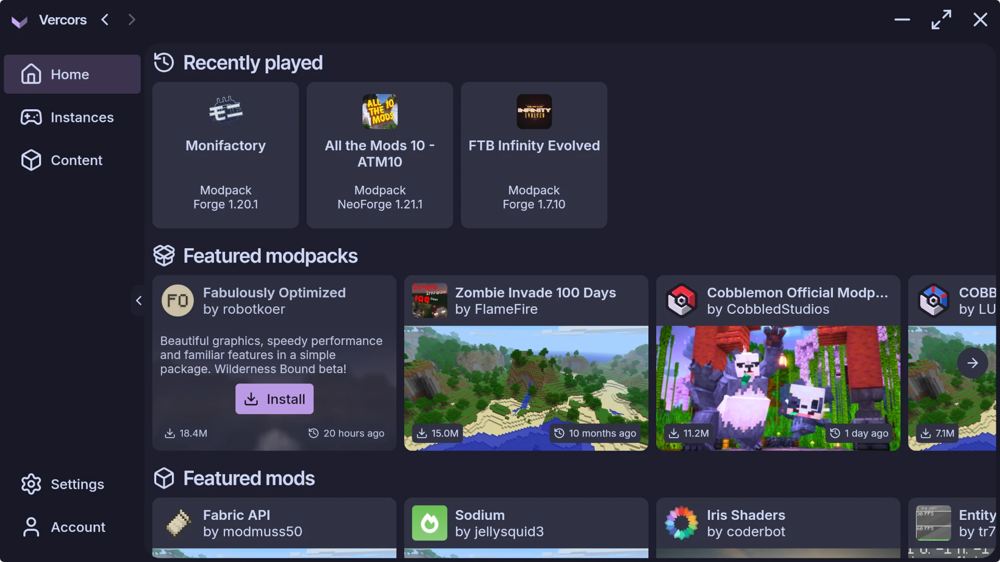
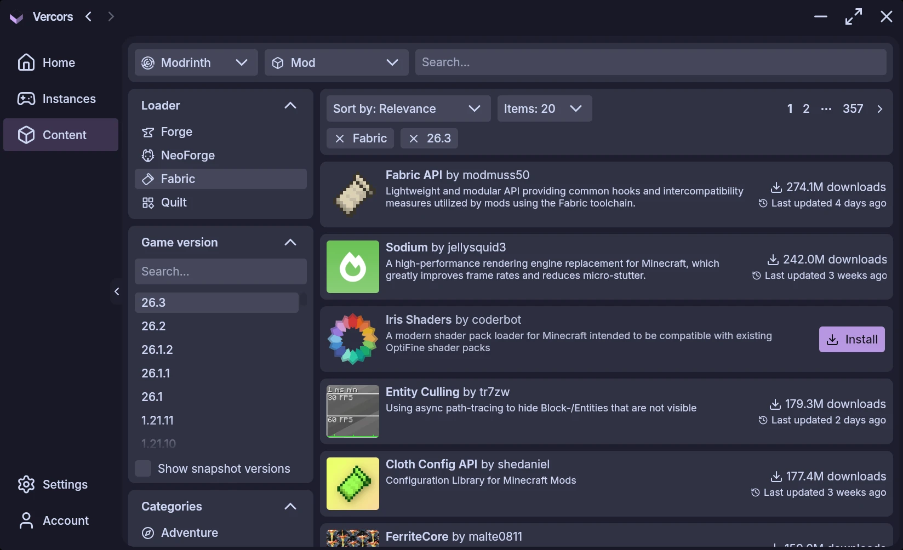
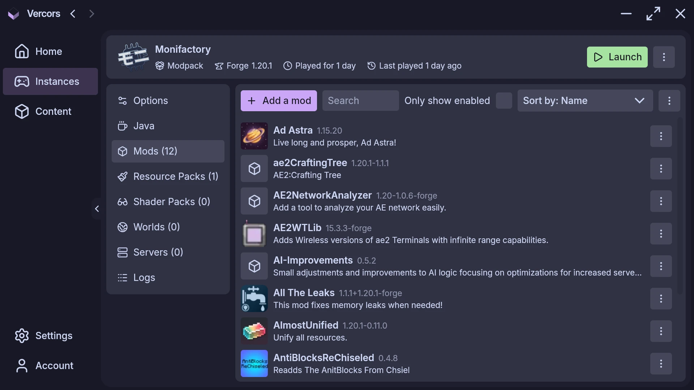

<h1 align="center">
  
  Vercors
</h1>

<h3 align="center">A modern Minecraft Launcher with mod support and much more!</h3>

<p align="center">
   
   
   
</p>

---

> [!IMPORTANT]
> This project is still in development. Please make sure to report any issues you
find [here](https://github.com/skyecodes/vercors/issues/new)!

Two versions of the launcher are available: a graphical user interface (GUI) and a command-line interface (CLI).

Downloads are available on the [Releases](https://github.com/skyecodes/vercors/releases) page.

## Supported platforms

- Windows: x64, arm64 (CLI for x64 only)
- Linux: x64, arm64
- macOS: arm64

## Available distribution formats

For the launcher GUI:

- Windows: EXE, MSI, NSIS, AppX, Portable, ZIP, TAR.GZ
- Linux: DEB, RPM, Pacman, Flatpak, Snap, AppImage, ZIP, TAR.GZ
- macOS: DMG, PKG, ZIP, TAR.GZ

For the launcher CLI:

- Windows: ZIP
- Linux: TAR.GZ
- macOS: TAR.GZ

## Build

### Requirements

* JDK 25

### Common steps

Clone the repository and navigate to the project directory

```
git clone https://github.com/skyecodes/vercors.git && cd vercors/
```

### Run the launcher (GUI)

Run the following command to run the launcher (GUI)

```
./gradlew :app:launcher-gui:run
```

### Run the launcher (CLI)

#### Windows (x64)

```
./gradlew :app:launcher-cli:runDebugExecutableMingwX64
cd app/launcher-cli/build/bin/mingwX64/debugExecutable/
./vercors.kexe --help
```

#### Linux (x64)

```
./gradlew :app:launcher-cli:runDebugExecutableLinuxX64
cd app/launcher-cli/build/bin/linuxX64/debugExecutable/
./vercors.kexe --help
```

#### Linux (arm64)

```
./gradlew :app:launcher-cli:runDebugExecutableLinuxArm64
cd app/launcher-cli/build/bin/linuxArm64/debugExecutable/
./vercors.kexe --help
```

#### macOS (arm64)

```
./gradlew :app:launcher-cli:runDebugExecutableMacosArm64
cd app/launcher-cli/build/bin/macosArm64/debugExecutable/
./vercors.kexe --help
```

### Run the backend

1. Set the `CURSEFORGE_API_KEY` environment variable to your CurseForge API key. You can get
   one [here](https://console.curseforge.com).
2. Run the following command to run the backend

```
./gradlew :app:meta:distribution:run
```
