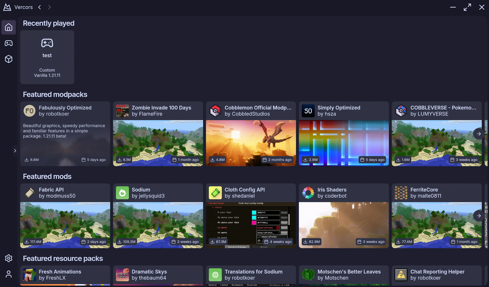
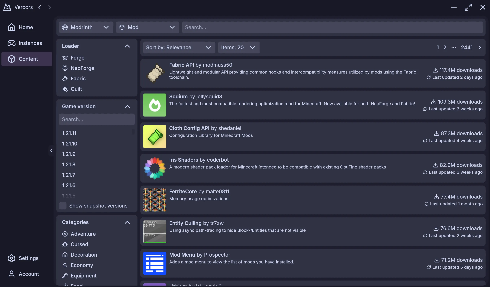

<h1 align="center">
  
  Vercors
</h1>

<h3 align="center">A modern Minecraft Launcher with mod support and much more!</h3>

<p align="center">
   
   
</p>

---

> This project is still early in development. No binaries are available for download, as no stable release has been made
> yet.
>
> If you still want to run the project yourself, you can clone the repository and follow the instructions in
> the [Build](#Build) section.

## Build

### Requirements

* JDK 25

### Common steps

Clone the repository and navigate to the project directory

```
git clone https://github.com/skyecodes/vercors.git && cd vercors/
```

### Run the launcher (GUI)

Run the following command to run the launcher (GUI)

```
./gradlew :app:launcher-gui:run
```

### Run the launcher (CLI)

#### Windows (x64)

```
./gradlew :app:launcher-cli:runDebugExecutableMingwX64
cd app/launcher-cli/build/bin/mingwX64/debugExecutable/
./vercors.kexe --help
```

#### Linux (x64)

```
./gradlew :app:launcher-cli:runDebugExecutableLinuxX64
cd app/launcher-cli/build/bin/linuxX64/debugExecutable/
./vercors.kexe --help
```

#### Linux (arm64)

```
./gradlew :app:launcher-cli:runDebugExecutableLinuxArm64
cd app/launcher-cli/build/bin/linuxArm64/debugExecutable/
./vercors.kexe --help
```

#### Mac OS (arm64 only, x64 is not supported)

```
./gradlew :app:launcher-cli:runDebugExecutableMacosArm64
cd app/launcher-cli/build/bin/macosArm64/debugExecutable/
./vercors.kexe --help
```

### Run the backend

1. Set the `CURSEFORGE_API_KEY` environment variable to your CurseForge API key. You can get
   one [here](https://console.curseforge.com).

2. Run the following command to run the backend

```
./gradlew :app:meta:distribution:run
```
